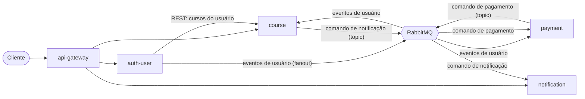

# Payment

## Sobre o projeto

Microsserviço de pagamentos da plataforma EAD. Recebe a solicitação de pagamento de um usuário, registra o pagamento e processa a cobrança de forma assíncrona: a requisição responde `202 Accepted`, um comando é publicado no RabbitMQ e o próprio serviço o consome para criar a cobrança no Stripe.

A integração com o Stripe usa o ambiente de testes. Projeto de portfólio com foco em processamento assíncrono e integração com gateway de pagamento.

> **Status:** em desenvolvimento. O fluxo de solicitação e o envio da cobrança ao Stripe funcionam; a atualização do status do pagamento após a resposta do Stripe ainda está em implementação.

## Funcionalidades

- Solicitação de pagamento por usuário, com validação dos dados (valor, CPF do titular, número do cartão, validade e código de segurança)
- Bloqueio de solicitação duplicada enquanto há pagamento em andamento ou ainda válido (30 dias)
- Processamento assíncrono: publicação e consumo de um comando de pagamento no RabbitMQ
- Criação da cobrança (`PaymentIntent`) no Stripe, em reais (BRL), com o método de pagamento de teste da Stripe
- Listagem paginada dos pagamentos de um usuário, com filtros, e consulta de um pagamento
- Consumo de eventos de usuário (`CREATE`, `UPDATE`, `DELETE`) para manter a cópia local dos usuários

### Endpoints

Contexto da aplicação: `/ead-payment/`, porta `8086`. A rota ainda não está registrada no gateway.

| Método | Rota | Acesso |
|---|---|---|
| POST | `/users/{userId}/payments` | USER |
| GET | `/users/{userId}/payments` | USER |
| GET | `/users/{userId}/payments/{paymentId}` | USER |

## Tecnologias utilizadas

- **Linguagem:** Java 21
- **Framework:** Spring Boot 4.1.1, Spring Web, Spring Data JPA
- **Banco de dados:** PostgreSQL
- **Segurança:** Spring Security, JWT (jjwt)
- **Microsserviços:** Spring Cloud 2025.1.3 (Eureka Client, Config Client)
- **Mensageria:** RabbitMQ (Spring AMQP)
- **Integrações:** Stripe (stripe-java)
- **Outros recursos:** Bean Validation (incluindo validação de CPF), filtros dinâmicos com Specifications (specification-arg-resolver), Actuator, Log4j2, Lombok
- **Build:** Maven

## Como executar o projeto

**Pré-requisitos:** Java 21, PostgreSQL, RabbitMQ, uma chave secreta de testes do Stripe e os serviços de infraestrutura no ar.

1. Suba, nesta ordem, o [service-registry](https://github.com/LGui-santos/service-registry) e o [config-server](https://github.com/LGui-santos/config-server). As configurações deste serviço ficam em [ead-config-server-repo](https://github.com/LGui-santos/ead-config-server-repo) (`ead-payment-service-dev.yaml`).
2. Crie o banco de dados `ead-payment` no PostgreSQL (as tabelas são criadas automaticamente).
3. Informe, no arquivo de configuração, o endereço do seu RabbitMQ (`spring.rabbitmq.addresses`) e a sua chave secreta de testes do Stripe (`ead.stripe.secretKey`).
4. Suba o [auth-user](https://github.com/LGui-santos/auth-user), que emite o token JWT e publica os eventos de usuário.
5. Clone o repositório e execute:
   ```bash
   git clone https://github.com/LGui-santos/payment.git
   cd payment
   ./mvnw spring-boot:run
   ```

O perfil ativo é `dev`. Os demais perfis ainda não foram configurados.

## Organização do projeto

```
src/main/java/com/ead/payment
├── controllers     # entrada das requisições REST
├── services        # regras de negócio e integração com o Stripe
├── repositories    # acesso a dados (Spring Data JPA)
├── models          # entidades: usuário, pagamento e cartão
├── dtos            # objetos de entrada e comandos
├── consumers       # consumo de eventos de usuário e comandos de pagamento
├── publishers      # publicação de comandos de pagamento
├── Specifications  # filtros dinâmicos
└── configs         # segurança (JWT) e RabbitMQ
```

## O que este projeto demonstra

- Processamento assíncrono de pagamento com RabbitMQ
- Integração com API externa (Stripe)
- Respostas HTTP adequadas ao fluxo assíncrono (`202 Accepted`)
- Regras de negócio sobre o ciclo de vida do pagamento
- Consistência de dados entre microsserviços por replicação orientada a eventos
- Validação de dados de entrada

## Próximos passos

- Atualizar o status do pagamento (`EFFECTED`, `REFUSED` ou `ERROR`) e a situação do usuário após a resposta do Stripe
- Usar os dados do cartão informado na cobrança, em vez do método de pagamento de teste
- Não armazenar número completo do cartão nem o código de segurança, usando tokenização do Stripe
- Registrar a rota do serviço no gateway
- Criar as configurações do perfil `prod`
- Ampliar os testes automatizados (hoje existe apenas o teste de carregamento do contexto)

## Ecossistema EAD

Este projeto faz parte de uma plataforma de educação a distância (EAD) construída em microsserviços. Os serviços se descobrem pelo Eureka, buscam configuração no Config Server e se comunicam por REST e por mensageria (RabbitMQ).

| Serviço | Papel | Porta (dev) |
|---|---|---|
| [service-registry](https://github.com/LGui-santos/service-registry) | Service Discovery (Eureka Server) | 8761 |
| [config-server](https://github.com/LGui-santos/config-server) | Configuração centralizada (Spring Cloud Config) | 8888 |
| [ead-config-server-repo](https://github.com/LGui-santos/ead-config-server-repo) | Repositório de configurações dos serviços | - |
| [api-gateway](https://github.com/LGui-santos/api-gateway) | Ponto único de entrada | 8080 |
| [auth-user](https://github.com/LGui-santos/auth-user) | Usuários, autenticação e autorização | 8087 |
| [course](https://github.com/LGui-santos/course) | Cursos, módulos, lições e inscrições | 8082 |
| [payment](https://github.com/LGui-santos/payment) | Pagamentos com Stripe (em desenvolvimento) | 8086 |
| [notification](https://github.com/LGui-santos/notification) | Notificações aos usuários | 8084 |
| [notification-hexagonal](https://github.com/LGui-santos/notification-hexagonal) | Notificações em arquitetura hexagonal | 8084 |


